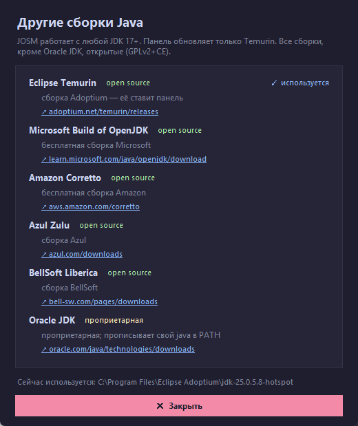

# JOSM & Nginx Control Panel

[Русская версия](README.md)

A small Windows control panel for **JOSM** and a local **Nginx** proxy used
with **NSPD / PKK** — Russia's National Spatial Data System and Public
Cadastral Map. It also keeps **Java** and the required **JOSM plugins** in
order.

> The interface is in Russian. NSPD / PKK is a Russian service, so the panel
> is intended primarily for Russian-speaking users. This English README is
> here to explain what the project does.


## What it does

- Downloads and updates **JOSM** (`josm-latest.jar` in `Downloads`) and
  launches it with the `java.exe` the panel found.
- Checks **Nginx**, updates it while **preserving your `nginx.conf`**, and
  starts/stops it. The config contains a local proxy for `nspd.gov.ru` on
  port **8081**.
- Finds **Java**, shows the vendor and JDK path, and updates **Eclipse
  Temurin** (silent MSI, one UAC prompt). A separate window lists other JDK
  builds — Microsoft OpenJDK, Amazon Corretto, Azul Zulu, BellSoft Liberica
  and Oracle JDK — with links and open-source/proprietary marks. Only Temurin
  is updated automatically.
- Checks **JOSM plugins** and installs the missing ones into
  `%APPDATA%\JOSM\plugins`:
  - **Russia Address Helper** — addresses from the Russian real-estate
    register (EGRN); required for the NSPD / PKK workflow;
  - **UtilsPlugin2** — editing utilities (optional);
  - **FilletTools** — fillet and chamfer tools (optional).



## Download

Get `JOSM_Control_Panel.exe` from
[Releases](https://github.com/Glebzilla/josm-control-panel/releases/latest).
Windows may show a SmartScreen warning because the build is not signed; the
source code is in this repository.

## Paths

The panel deliberately uses fixed paths:

| Item | Location |
|---|---|
| JOSM | `%USERPROFILE%\Downloads\josm-latest.jar` |
| Nginx | `%USERPROFILE%\Downloads\nginx-<version>\nginx.exe` |
| Java | `PATH`, then `Program Files\Eclipse Adoptium`, `Program Files\Java`, `Program Files (x86)\Eclipse Adoptium` |
| JOSM plugins | `%APPDATA%\JOSM\plugins` |

**Nginx in `Program Files`, the root of `C:\` or `%TEMP%` is not supported.**
The official Windows build is a portable ZIP that writes `logs`, `temp` and
`nginx.pid` next to itself; those locations are not writable for a normal
user (or are cleaned automatically). The panel only scans `Downloads`.

## Run from source

Python 3.10+ with tkinter (included in the standard Windows installer):

```bat
pythonw josm_control_panel.pyw
```

Build the exe:

```bat
pip install -r requirements.txt
build.bat
```

The result is `dist\JOSM_Control_Panel.exe`.

## License

MIT — see [LICENSE](LICENSE).

## Author

Gleb — [github.com/Glebzilla](https://github.com/Glebzilla)

The code was written with AI assistance (DeepSeek in OpenCode) and tested by
the author on a real machine.
