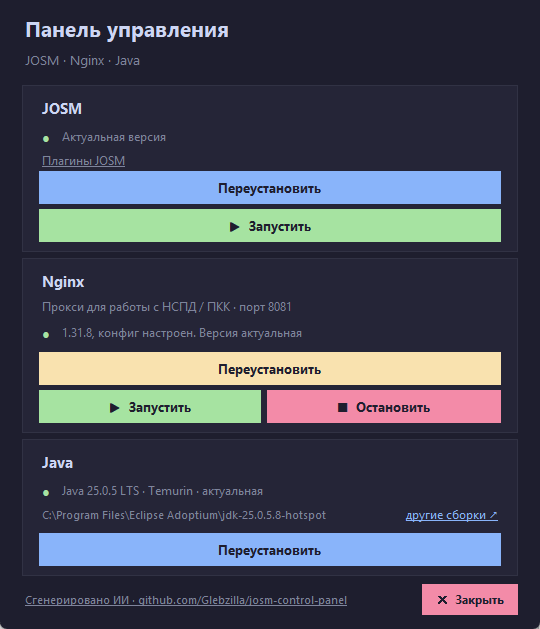

# JOSM & Nginx Control Panel

Небольшая панель для Windows, которая держит в порядке рабочий набор для
**НСПД / ПКК**: JOSM, локальный Nginx-прокси на `nspd.gov.ru` (порт 8081),
Java и плагины JOSM.



## Зачем это нужно

Для работы с НСПД / ПКК JOSM обращается к `nspd.gov.ru` через локальный
Nginx-прокси на порту **8081**. Панель:

- скачивает и обновляет **JOSM** (`josm-latest.jar` в `Downloads`);
- проверяет **Nginx**, сравнивает установленную версию с последней и
  обновляет её, **сохраняя рабочий `nginx.conf`** с прокси на `nspd.gov.ru`;
- запускает и останавливает Nginx;
- проверяет **Java (Temurin)**, сравнивает с актуальной версией и при
  необходимости ставит обновление;
- проверяет **плагины JOSM** и при необходимости ставит их:
  - **Russia Address Helper** — загрузка адресов из ЕГРН; нужен для работы
    с НСПД / ПКК;
  - **UtilsPlugin2** — набор утилит для редактирования;
  - **FilletTools** — скругление углов и фаски.

Обязателен только Address Helper: без него локальный Nginx-прокси на 8081
не нужен. Остальные два — по желанию, панель просто помогает их поставить.

## Плагины и их источники

| Плагин | Источник | Что делает |
|---|---|---|
| Russia Address Helper | [github.com/micronull/JOSM-Russia-address-helper-plugin](https://github.com/micronull/JOSM-Russia-address-helper-plugin) | адреса из ЕГРН, работа с НСПД / ПКК |
| UtilsPlugin2 | [josm.openstreetmap.de · UtilsPlugin2](https://josm.openstreetmap.de/wiki/Help/Plugin/UtilsPlugin2) | копирование, выравнивание, замена геометрии |
| FilletTools | [gitlab.com/darkonus/josm-fillet-tools](https://gitlab.com/darkonus/josm-fillet-tools) | скругление углов (fillet) и фаски |

Панель скачивает jar-файлы из этих источников в `%APPDATA%\JOSM\plugins`.
Ссылки в окне «Плагины JOSM» кликабельны.

## Быстрый старт

1. Скачайте `JOSM_Control_Panel.exe` из
   [Releases](https://github.com/Glebzilla/josm-control-panel/releases/latest).
2. Запустите. Windows может показать SmartScreen («Неизвестный издатель») —
   это обычный PyInstaller-сборщик, исходник лежит рядом в репозитории.
3. Нажмите «Обновить» у JOSM, «Установить/Обновить» у Nginx, проверьте Java.
4. В строке «Плагины JOSM» откройте окно и поставьте недостающие.
5. Запустите Nginx кнопкой «Запустить» — прокси будет доступен на
   `http://localhost:8081`.

## Запуск из исходника

Нужен Python 3.10+ (tkinter входит в стандартную поставку Python для Windows).

```bat
pythonw josm_control_panel.pyw
```

## Сборка exe

```bat
build.bat
```

Готовый файл появится в `dist\JOSM_Control_Panel.exe`. Нужен
`pip install pyinstaller` (см. `requirements.txt`).

## Что важно знать

- **Конфиг Nginx сохраняется.** При обновлении панель запоминает ваш
  `conf\nginx.conf` (с блоком `server { listen 8081; ... nspd.gov.ru }`)
  и возвращает его на место после распаковки новой версии.
- **Nginx останавливается перед обновлением** — после него нажмите
  «Запустить» заново.
- **Java ставится с одним запросом UAC.** Скачивается MSI Temurin в
  `Downloads`, установка тихая. После установки может понадобиться
  перезапустить панель и JOSM, чтобы обновился `PATH`.
- **Плагины JOSM** скачиваются в `%APPDATA%\JOSM\plugins`. Если JOSM
  запущен и держит файл — закройте его и повторите. После установки JOSM
  нужно перезапустить.
- **Старые версии Nginx** из `Downloads` удаляются автоматически.
- Панель рассчитана на экраны от **1280×720**: высота окна подстраивается
  под экран.

## Структура

```
josm_control_panel.pyw   — исходник панели
josm_control_panel.ico   — иконка
build.bat                — сборка exe (PyInstaller)
requirements.txt         — зависимости для сборки
docs/screenshot.png      — скриншот
```

## Лицензия

MIT — см. [LICENSE](LICENSE).

## Автор

Gleb — [github.com/Glebzilla](https://github.com/Glebzilla)

Код написан с помощью ИИ (DeepSeek в OpenCode) и проверен автором на
реальной машине: обновление Nginx с сохранением конфига, установка Java,
проверка и установка плагинов JOSM.
